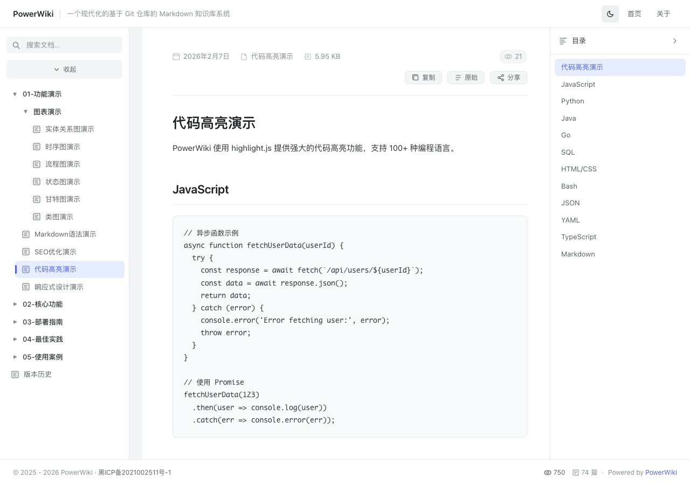

# 本地图片演示

本页使用仓库中的真实截图，不依赖外部图床。点击图片体验大图查看。

## 技术文档界面

下图通过 `../images/code.jpg` 引用上级目录中的图片。



## Mermaid 时序图

下图通过 `/images/mermaid.jpg` 引用仓库根目录图片。实际 Mermaid 渲染请打开 [时序图演示](/post/01-功能演示/图表演示/时序图演示.md)。


## 编写方式

```markdown


```

图片与文章一起提交到 Git。文件名大小写需一致；较大图片应先压缩，避免增加首次克隆与下载时间。
