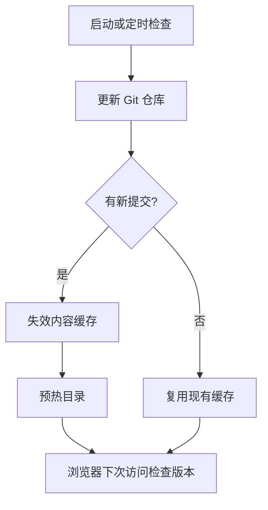

# 自动同步机制

PowerWiki 启动时克隆或更新仓库，运行期间按配置间隔检查远端。同步间隔与缓存失效是两件事：没有新提交时，菜单和文章继续复用。



## 配置同步间隔

```json
{
  "autoSyncInterval": 180000
}
```

单位为毫秒，默认 3 分钟。缩短间隔会增加远端 Git 检查频率，并不会提高缓存命中后的阅读速度。

## 提交后如何确认

1. 将文档提交并推送到配置指定的分支。
2. 等待一个同步周期，查看服务日志确认成功。
3. 重新打开文章或刷新页面，浏览器会检查新版本。

```bash
docker logs --tail 100 powerwiki
```

重启也会触发启动同步，但日常更新不需要每次重启。仓库地址或分支修改需要重启。首次克隆仍受网络和仓库大小影响，建议保留 Git 缓存卷。

参见 [性能与缓存](/post/02-核心功能/性能与缓存.md)。
